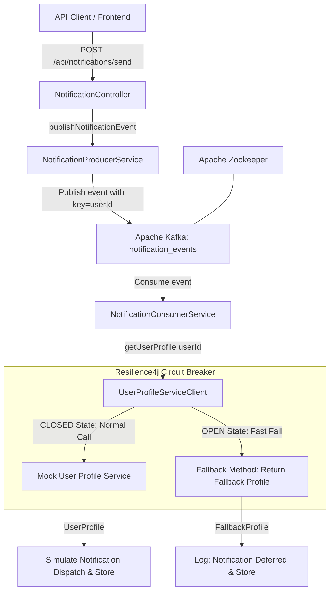

# Resilient Notification Service with Apache Kafka & Circuit Breaker Pattern

[](https://spring.io/projects/spring-boot)
[](https://kafka.apache.org/)
[](https://resilience4j.readme.io/)
[](https://docs.docker.com/compose/)
[](https://www.oracle.com/java/)

A production-grade, event-driven notification microservice engineered in **Java 17 / Spring Boot 3** demonstrating **Event-Driven Architecture (EDA)** with **Apache Kafka** and the **Circuit Breaker Pattern** with **Resilience4j**.

---

## Table of Contents
1. [Project Overview](#project-overview)
2. [Architecture Diagram](#architecture-diagram)
3. [Key Features & Design Principles](#key-features--design-principles)
4. [Tech Stack](#tech-stack)
5. [Quick Start with Docker Compose](#quick-start-with-docker-compose)
6. [API Documentation](#api-documentation)
7. [Step-by-Step Circuit Breaker Testing Guide](#step-by-step-circuit-breaker-testing-guide)
8. [Automated Test Suite](#automated-test-suite)
9. [Technical Decisions & Trade-offs](#technical-decisions--trade-offs)
10. [Observability & Monitoring](#observability--monitoring)

---

## 1. Project Overview
In modern distributed microservices, external service dependencies (such as a User Profile Service) can experience network latency, service degradation, or complete outages. Synchronously blocking consumer threads or allowing cascading failures degrades the entire ecosystem.

This service implements:
- **Asynchronous Ingestion**: The REST API accepts notification requests and returns `HTTP 202 Accepted` immediately.
- **Message Decoupling via Kafka**: Requests are serialized as immutable `NotificationEvent`s and partitioned by `userId`.
- **Downstream Protection via Circuit Breaker**: The consumer retrieves recipient contact details via `UserProfileServiceClient`, guarded by **Resilience4j**.
- **Fail-Fast & Fallbacks**: When downstream failures exceed 50%, calls fail fast without network execution, gracefully deferring notifications using a fallback profile.
- **Self-Healing**: Automatically tests service health in `HALF_OPEN` state and restores to `CLOSED` when healthy.

---

## 2. Architecture Diagram



---

## 3. Key Features & Design Principles

- **Event-Driven Architecture**: Asynchronous publish-subscribe messaging completely decouples ingestion from notification dispatching.
- **Partition Affinity**: Kafka messages use `userId` as the partitioning key. This guarantees strict chronological ordering for events belonging to the same user.
- **Fail-Fast Resilience**: Prevents thread exhaustion by rejecting calls instantly when the external service is failing.
- **Observable State Transitions**: All circuit breaker transitions (`CLOSED -> OPEN -> HALF_OPEN -> CLOSED`) and non-permitted calls are logged in real-time.
- **End-to-End Containerization**: Orchestrated via Docker Compose with healthchecks on all services.

---

## 4. Tech Stack

- **Language & Runtime**: Java 17 (OpenJDK / Eclipse Temurin)
- **Framework**: Spring Boot 3.3.4 (Spring Web, Spring Actuator, Spring AOP)
- **Messaging Broker**: Apache Kafka 7.4.0 & Apache Zookeeper 7.4.0 (Confluent Platform)
- **Fault Tolerance**: Resilience4j 2.2.0 (Spring Boot 3 starter & Micrometer)
- **Containerization**: Docker & Docker Compose v3.8
- **Testing**: JUnit 5, Mockito, Spring Kafka Test (`@EmbeddedKafka`), AssertJ

---

## 5. Quick Start with Docker Compose

### Prerequisites
- Docker Engine 20.10+
- Docker Compose v2.0+

### One-Command Setup
Clone the repository and launch the entire cluster:

```bash
# Clone the repository
git clone <repo-url>
cd Notification

# Build and start Zookeeper, Kafka, and Notification Service
docker compose up --build -d
```

### Verify Service Health
Monitor container startup:
```bash
docker compose ps
```

Check the Spring Boot Actuator health endpoint:
```bash
curl http://localhost:8080/actuator/health
```

Expected response:
```json
{
  "status": "UP",
  "components": {
    "circuitBreakers": {
      "status": "UP",
      "details": {
        "userProfileService": {
          "status": "UP",
          "details": {
            "failureRate": "-1.0%",
            "failureRateThreshold": "50.0%",
            "slowCallRate": "-1.0%",
            "slowCallRateThreshold": "100.0%",
            "bufferedCalls": 0,
            "slowCalls": 0,
            "slowFailedCalls": 0,
            "failedCalls": 0,
            "notPermittedCalls": 0,
            "state": "CLOSED"
          }
        }
      }
    }
  }
}
```

### Stopping the System
```bash
docker compose down
```

---

## 6. API Documentation

### 6.1 Send Notification
- **Endpoint**: `POST /api/notifications/send`
- **Status Code**: `202 Accepted`
- **Description**: Publishes notification event to Kafka topic `notification_events`.

#### Request Body
```json
{
  "userId": "usr_9812",
  "message": "Your package has arrived at the collection center.",
  "notificationType": "SMS"
}
```

#### Sample cURL
```bash
curl -X POST http://localhost:8080/api/notifications/send \
  -H "Content-Type: application/json" \
  -d '{
    "userId": "usr_9812",
    "message": "Your package has arrived at the collection center.",
    "notificationType": "SMS"
  }'
```

#### Expected Response:
```text
Notification request received and queued.
```

---

### 6.2 View Processed Notifications
- **Endpoint**: `GET /api/notifications/records`
- **Description**: Retrieves in-memory log of notifications processed by the Kafka consumer.

```bash
curl http://localhost:8080/api/notifications/records
```

#### Sample Response:
```json
[
  {
    "eventId": "229158c5-dafa-41aa-8526-9d3e5e6e8c71",
    "userId": "usr_9812",
    "email": "usr_9812@example.com",
    "phoneNumber": "+1-usr-555-0100",
    "message": "Your package has arrived at the collection center.",
    "notificationType": "SMS",
    "status": "SENT",
    "processedAt": "2026-10-03T10:45:00"
  }
]
```

---

### 6.3 Mock User Profile Service & Fault Simulation Endpoints

| Endpoint | Method | Description |
|---|---|---|
| `/mock-users/{userId}` | `GET` | Fetches simulated user contact details. Supports `?fail=true` (HTTP 500) and `?delay=3000` (ms). |
| `/mock-users/configure?fail=true` | `POST` | Dynamically triggers global failure mode for all consumer calls. |
| `/mock-users/configure?fail=false` | `POST` | Restores normal mock service operation. |
| `/mock-users/configure` | `GET` | Returns current mock configuration status. |

---

## 7. Step-by-Step Circuit Breaker Testing Guide

Follow these steps to observe the complete Circuit Breaker state transitions (`CLOSED -> OPEN -> HALF_OPEN -> CLOSED`).

### Step 1: Verify Initial CLOSED State
Verify the circuit breaker is healthy:
```bash
curl http://localhost:8080/actuator/circuitbreakers
```
*Expected State:* `"state": "CLOSED"`

Send a normal notification:
```bash
curl -X POST http://localhost:8080/api/notifications/send \
  -H "Content-Type: application/json" \
  -d '{"userId": "user1", "message": "Welcome!", "notificationType": "EMAIL"}'
```
*Log Output:*
```text
Consumed event for user: user1, type: EMAIL
Attempting to call User Profile Service for user: user1
[NOTIFICATION SENT] Notification successfully dispatched to user: user1 [Email: user1@example.com, Phone: +1-use-555-0100] Message: Welcome!
```

---

### Step 2: Trip Circuit Breaker into OPEN State
Enable global failure on the mock service:
```bash
curl -X POST "http://localhost:8080/mock-users/configure?fail=true"
```

Send 4 notification requests to exceed the `failureRateThreshold` (50% with `minimumNumberOfCalls=4`):
```bash
for i in 1 2 3 4; do
  curl -s -X POST http://localhost:8080/api/notifications/send \
    -H "Content-Type: application/json" \
    -d "{\"userId\": \"failUser$i\", \"message\": \"Test\", \"notificationType\": \"EMAIL\"}"
done
```

*Log Output:*
```text
Circuit Breaker open or call failed for user: failUser1. Error: 500 Internal Server Error - Circuit Breaker open, notification deferred
[NOTIFICATION DEFERRED] Fallback user profile used for user: failUser1. Notification deferred due to external service unavailability.
...
>>> [CIRCUIT BREAKER STATE TRANSITION] userProfileService transitioned from CLOSED to OPEN
```

Verify the state has transitioned to `OPEN`:
```bash
curl http://localhost:8080/actuator/circuitbreakers
```
*Expected State:* `"state": "OPEN"`

---

### Step 3: Verify Fast-Fail in OPEN State
Send another notification while `OPEN`:
```bash
curl -X POST http://localhost:8080/api/notifications/send \
  -H "Content-Type: application/json" \
  -d '{"userId": "fastFailUser", "message": "Urgent alert", "notificationType": "SMS"}'
```

*Log Output:*
```text
>>> [CIRCUIT BREAKER CALL NOT PERMITTED] Instance: userProfileService is in OPEN state. Request failed fast without network call.
Circuit Breaker open or call failed for user: fastFailUser. Error: CircuitBreaker 'userProfileService' is OPEN and does not permit further calls - Circuit Breaker open, notification deferred
[NOTIFICATION DEFERRED] Fallback user profile used for user: fastFailUser. Notification deferred due to external service unavailability.
```
Notice: **No outbound HTTP request was attempted.** The call failed fast and safely triggered the fallback.

---

### Step 4: Recover to HALF_OPEN and CLOSED
1. Restore the mock service:
```bash
curl -X POST "http://localhost:8080/mock-users/configure?fail=false"
```

2. Wait **5 seconds** (configured `waitDurationInOpenState: 5s`). The circuit breaker transitions to `HALF_OPEN`.

3. Send 2 successful requests (the configured `permittedNumberOfCallsInHalfOpenState`):
```bash
curl -X POST http://localhost:8080/api/notifications/send \
  -H "Content-Type: application/json" \
  -d '{"userId": "recoveryUser1", "message": "Ping 1", "notificationType": "EMAIL"}'

curl -X POST http://localhost:8080/api/notifications/send \
  -H "Content-Type: application/json" \
  -d '{"userId": "recoveryUser2", "message": "Ping 2", "notificationType": "EMAIL"}'
```

*Log Output:*
```text
>>> [CIRCUIT BREAKER STATE TRANSITION] userProfileService transitioned from OPEN to HALF_OPEN
[NOTIFICATION SENT] Notification successfully dispatched to user: recoveryUser1
[NOTIFICATION SENT] Notification successfully dispatched to user: recoveryUser2
>>> [CIRCUIT BREAKER STATE TRANSITION] userProfileService transitioned from HALF_OPEN to CLOSED
```

---

## 8. Automated Test Suite

The project includes unit and integration tests:

1. **`NotificationProducerServiceTest`**: Validates event serialization and Kafka key partitioning.
2. **`UserProfileServiceClientTest`**: Tests normal REST client behavior and fallback invocation.
3. **`CircuitBreakerIntegrationTest`**: Tests full Resilience4j lifecycle (`CLOSED -> OPEN -> HALF_OPEN -> CLOSED`) with Spring Boot context.
4. **`NotificationEndToEndIntegrationTest`**: Runs `@EmbeddedKafka` to verify end-to-end event production, broker transport, and consumer processing.

### Run Tests Locally
```bash
./gradlew test
```

Or using Docker:
```bash
docker run --rm -v "%cd%":/app -w /app gradle:8.7-jdk17 gradle test
```

---

## 9. Technical Decisions & Trade-offs

1. **Apache Kafka over RabbitMQ**:
   - Kafka provides partitioned log streams that guarantee message ordering per `userId` at enterprise scale.
   - Built-in offset management allows idempotent replays and auditability.
2. **Resilience4j over Netflix Hystrix**:
   - Netflix Hystrix is officially deprecated; Resilience4j is designed for Java 17 and Spring Boot 3 with zero external runtime dependencies.
3. **Keyed Partitioning on `userId`**:
   - Guarantees sequential notification handling per user while allowing independent horizontal scaling of consumer instances across multiple partitions.
4. **Idempotent Kafka Producer**:
   - Configured `enable.idempotence: true` and `acks: all` ensures zero duplicate messages during network retries.
5. **Spring Kafka `DefaultErrorHandler`**:
   - Implements backoff retries and error-handling deserializers to prevent consumer poison-pill crashes.

---

## 10. Observability & Monitoring

The service exposes production-ready endpoints via Spring Boot Actuator:
- `GET /actuator/health` — Microservice health and circuit breaker status.
- `GET /actuator/circuitbreakers` — Call counts, failure rates, buffered calls, and states.
- `GET /actuator/circuitbreakerevents` — Chronological transition events stream.
- `GET /actuator/metrics` — Micrometer metrics.
- Postman Collection: Import `Notification_Service.postman_collection.json` directly into Postman for ready-to-run requests.
